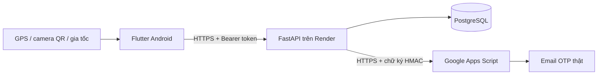

# Giải thích source để thuyết trình

## Luồng tổng thể

Flutter hiển thị giao diện và lấy dữ liệu thiết bị. FastAPI xác thực, phân quyền và quyết định có ghi công hay không. PostgreSQL lưu dữ liệu qua các lần restart. Apps Script chỉ nhận yêu cầu có chữ ký hợp lệ và gửi OTP, không quyết định đăng nhập.

## Các bảng chính

- `users`: email/tên đăng nhập duy nhất, hash Argon2, vai trò, trạng thái xác thực và khóa.
- `challenges`: mã OTP đã hash HMAC theo challenge ID, mục đích, hạn, số lần thử và trạng thái đã dùng.
- `auth_sessions`: phiên đăng nhập phía máy chủ để thu hồi khi logout/khóa tài khoản.
- `sites`: điểm chấm công, tọa độ, bán kính, phiên bản QR.
- `shifts`: giờ vào/ra, điểm chấm công, số phút được trễ.
- `assignments`: nhân viên + ca + ngày bắt đầu; kiểm tra trùng khoảng thời gian, kể cả ca đêm.
- `attendances`: tối đa một bản ghi cho mỗi phân ca; chứa giờ vào/ra và hồ sơ cảm biến tương ứng.
- `corrections`: yêu cầu điều chỉnh, giờ đề xuất, lý do, hồ sơ, kết quả/nhận xét/người duyệt.
- `audit_logs`: ai làm gì, với dữ liệu nào, khi nào; lưu trạng thái cũ khi duyệt điều chỉnh.
- `throttles`: giới hạn số lần thử đăng nhập/đăng ký; dữ liệu không mất chỉ vì restart web service.

## Đăng nhập hoạt động thế nào?

1. Flutter gửi tên đăng nhập và mật khẩu đến `/auth/login`.
2. Backend đối chiếu hash Argon2 và trạng thái tài khoản. Sai thì từ chối; chưa có token đăng nhập.
3. Đúng mật khẩu thì tạo challenge, sinh mã ngẫu nhiên 6 số và gửi đến email đã gắn với tài khoản.
4. App chỉ nhận challenge ID, email che bớt và thời hạn; không nhận mã OTP.
5. Người dùng nhập OTP, app gọi `/auth/verify`.
6. Backend kiểm tra hạn, số lần thử, trạng thái đã dùng và hash của mã. Đúng mới tạo phiên và JWT.
7. Mỗi API được bảo vệ kiểm tra JWT, phiên còn hiệu lực và vai trò/chủ sở hữu trong database.

## Chấm công hoạt động thế nào?

1. Admin tạo điểm, ca và phân ca.
2. Admin mở QR, backend ký token gắn điểm, phiên bản và thời hạn 90 giây.
3. Nhân viên chọn ca của mình, quét QR bằng camera, xem vị trí/chuyển động.
4. Khi nhấn xác nhận, app lấy lại GPS và mẫu chuyển động 3 giây rồi gửi `/attendance/check`.
5. Backend kiểm tra chủ ca, giờ ca, QR, tọa độ/độ chính xác/tuổi mẫu/cờ mô phỏng, cấu trúc mẫu chuyển động và bản ghi trùng.
6. Đủ điều kiện mới ghi thời gian của máy chủ và hồ sơ. Không đủ thì trả các lý do để hiển thị và hỗ trợ giải trình.

## RMS chuyển động là gì?

`userAccelerometerEventStream` cung cấp gia tốc đã tách trọng lực trên ba trục. Với mỗi mẫu, độ lớn là `sqrt(x² + y² + z²)`. RMS của cửa sổ 3 giây là `sqrt(mean(x² + y² + z²))`, đơn vị m/s². Đồ thị và số liệu là phép đo, không được gọi là thuật toán nhận diện danh tính.

## Khi nào không được xóa?

CRUD vẫn có kiểm tra quan hệ dữ liệu. Ví dụ điểm chấm công đang được ca tham chiếu không bị xóa, nhân viên có lịch sử phải khóa thay vì xóa mất công. Tạo/sửa/xóa bản ghi mới chưa bị tham chiếu để demo đủ CRUD.

## Tìm code ở đâu?

| Nội dung | File |
|---|---|
| Kết nối API và thông báo lỗi | `lib/src/api.dart` |
| Giữ phiên và secure storage | `lib/src/session.dart` |
| Đăng ký, mật khẩu, OTP | `lib/src/auth.dart` |
| Dashboard, bảng công, tài khoản | `lib/src/shell.dart` |
| Form CRUD và hiển thị QR | `lib/src/management.dart` |
| GPS và phép đo chuyển động | `lib/src/device.dart` |
| Luồng chấm công và quét camera | `lib/src/checkin.dart` |
| Gửi, sửa, xóa, duyệt giải trình | `lib/src/corrections.dart` |
| Luật nghiệp vụ và endpoint | `backend/app/main.py` |
| OTP, JWT, giới hạn thử, quyền | `backend/app/security.py` |
| Cấu trúc database | `backend/app/db.py` |
| Gửi email thật | `backend/app/mailer.py`, `deploy/email/Code.gs` |
